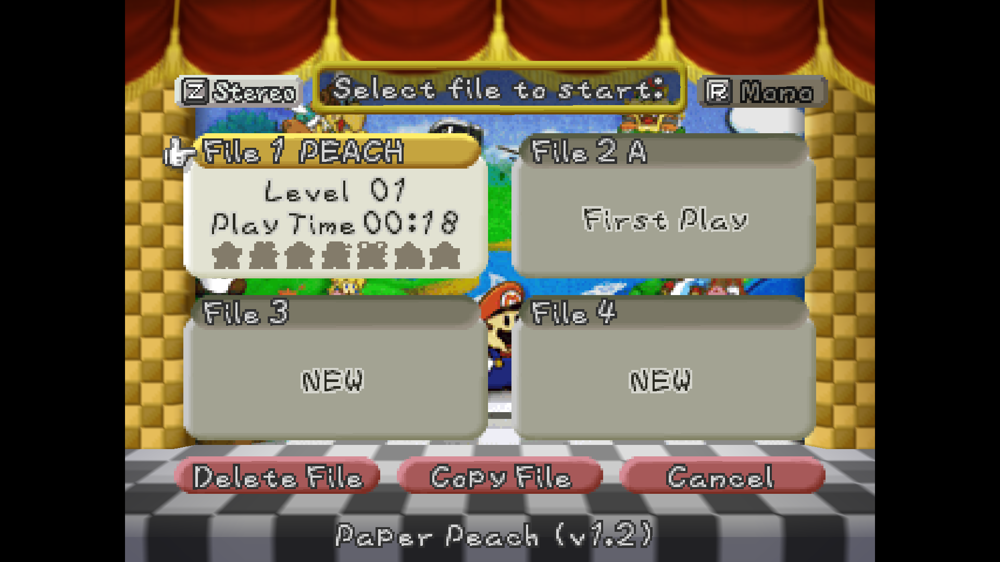
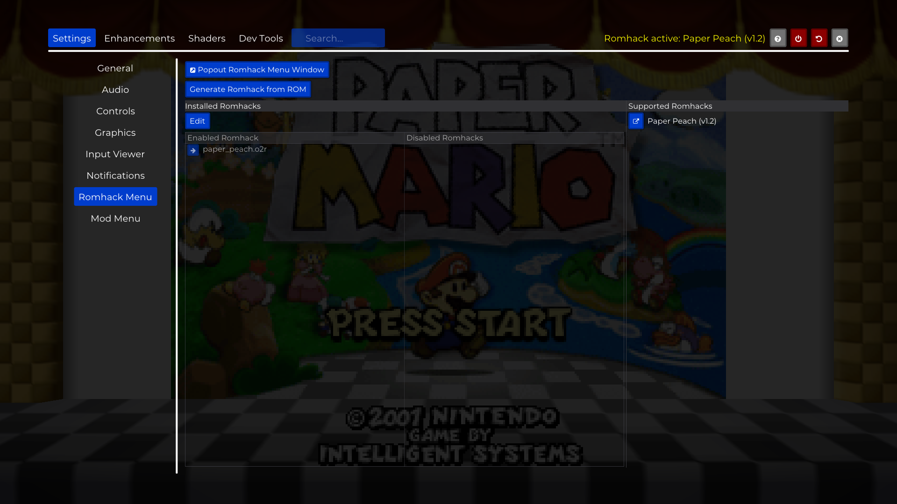

# Playing a romhack

This guide walks through playing a romhack in Paperboat, from downloading it, to switching back to the base game.

## Before you start

You need:

1. **Paperboat already set up with the base game.** The first time you started Paperboat, it asked for your Paper Mario ROM and generated the game files. A romhack loads on top of those files, so this step has to be done first.
2. **A US Paper Mario ROM** (`.z64`). Romhacks are made for the US version of the game.
3. **A supported romhack.** Open **Settings -> Romhack Menu -> Supported Romhacks** in Paperboat. Every romhack listed there has a link button that opens its download page.

## Step 1: Patch the romhack

Romhacks are downloaded as a patch file (`.bps`), you apply the patch to your own ROM to get the romhack ROM.

1. Download the romhack from its page.
2. Open a ROM patching tool, for example [Rom Patcher JS](https://www.marcrobledo.com/RomPatcher.js/).
3. Pick your **US Paper Mario ROM** as the ROM file and the romhack's **patch file** as the patch.
4. Apply the patch and save the result, e.g. `Paper Peach.z64`.

## Step 2: Add the romhack to Paperboat

1. Start Paperboat and open the menu.
2. Go to **Settings → Romhack Menu**.
3. Click **Generate Romhack from ROM**, then **Select ROM**.
4. Pick the patched romhack ROM from step 1.
5. Wait for the progress bar to finish. This takes a short while, and only has to be done once per romhack.
6. When **Romhack Ready** shows up, click **Play** to restart Paperboat into the romhack, or **Later** to keep playing what you're playing now.

While a romhack is active, the menu header shows **Romhack active: NAME** and the file select screen shows the romhack's name and version at the bottom.

## Switching romhacks, or going back to the base game

Only one romhack can be active at a time. To change it:

1. Go to **Settings -> Romhack Menu -> Installed Romhacks**.
2. Click **Edit**.
3. Use the arrow buttons to move a romhack into **Enabled Romhack**, or out of it.
   - To play the base game again, move the active romhack to **Disabled Romhacks**, or click **Clear List**.
4. Click **Apply & Restart**. Paperboat restarts with your choice.

## Saves

Each romhack keeps its own save files, separate from the base game and from other romhacks. Switching between them never overwrites another game's saves. The saves would be available under `saves/~romhacks/<ROMHACK_NAME>`.

## Mods and HD packs

The HD pack and mods from the **Mod Menu** still work while a romhack is active. They load on top of the romhack, so a mod that changes something the romhack also changed wins.

A romhack or mod can turn off PaperBoat options that would break it. Those options are greyed out, and hovering one says which romhack or mod turned it off; your own setting comes back when you play without it. Importing an N64 save is turned off while any romhack is loaded. A romhack o2r extracted with an older Paperboat still gets these rules; extracting it again stores them in the o2r. The Blueprint Editor keeps separate presets per romhack, saved next to that romhack's saves. A mod that says it only works with another base (vanilla or a different romhack) isn't loaded, and the Mod Menu shows it greyed with a warning icon that explains why.

## Common errors

| Message | What it means | What to do |
|---|---|---|
| **Not a Supported Romhack** | The ROM you picked is not one Paperboat has a recipe for. | Check that the romhack is in the **Supported Romhacks** list, that you patched it onto a **US** ROM, and that you picked the patched `.z64` and not the original. Different versions of the same romhack give different ROMs; only the listed version is supported. |
| **Base Game Required** | You picked a romhack ROM when Paperboat asked for the base game. | Pick your original US Paper Mario ROM first. Add the romhack afterwards through the Romhack Menu. |
| **Romhack Extraction Failed** | Something went wrong while generating the romhack files. | Try again. If it keeps failing, report it with the message shown. |

## Where the files are

You don't need to touch these files, but they're useful to know about when backing up or reporting a problem. All paths are inside the Paperboat folder.

| What | Where |
|---|---|
| Romhack files | `mods/~romhacks/<romhack>.o2r` |
| Romhack saves | `saves/~romhacks/<romhack>/` |

> [!NOTE]
> Starting a folder name with `~` means it's a reserved folder managed by Paperboat.

Deleting a romhack's `.o2r` file removes the romhack. Its saves stay in place, and come back if you add the romhack again.
